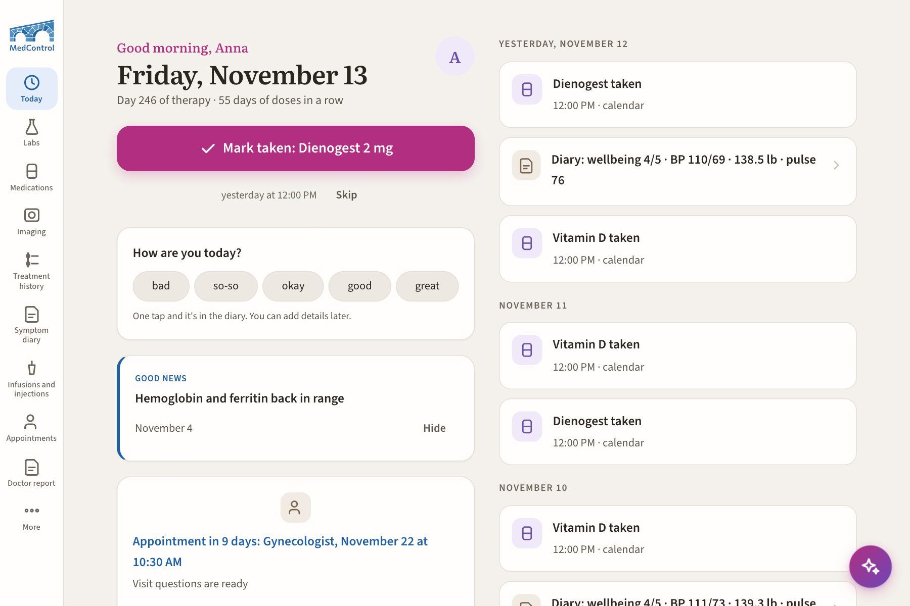
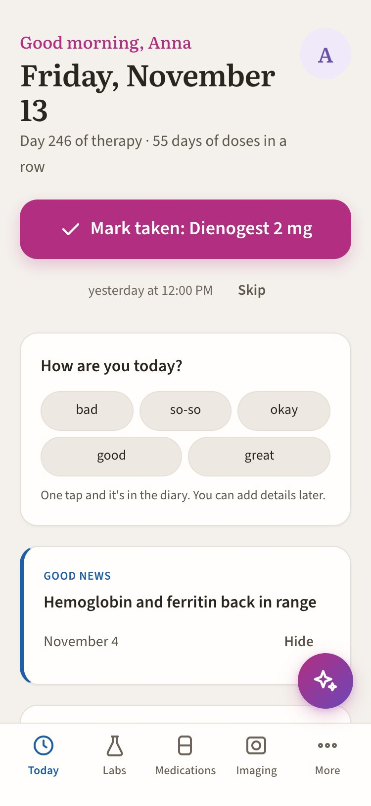
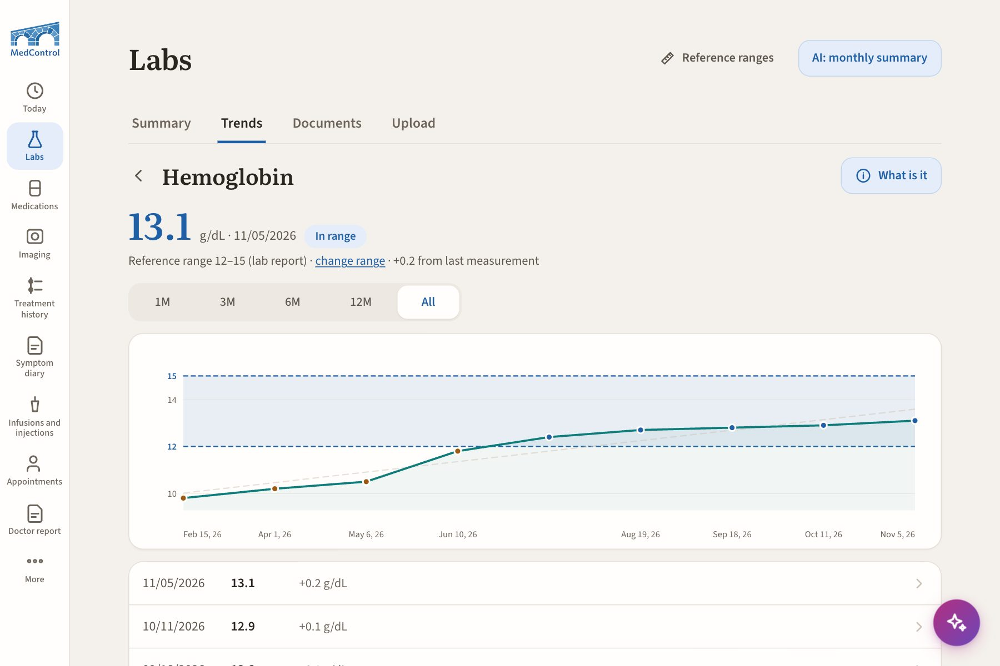
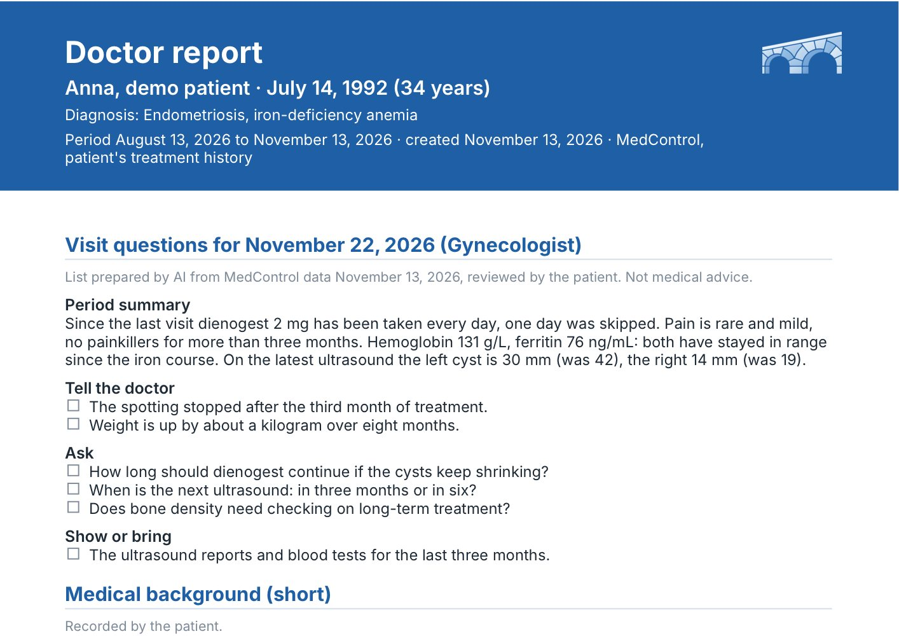
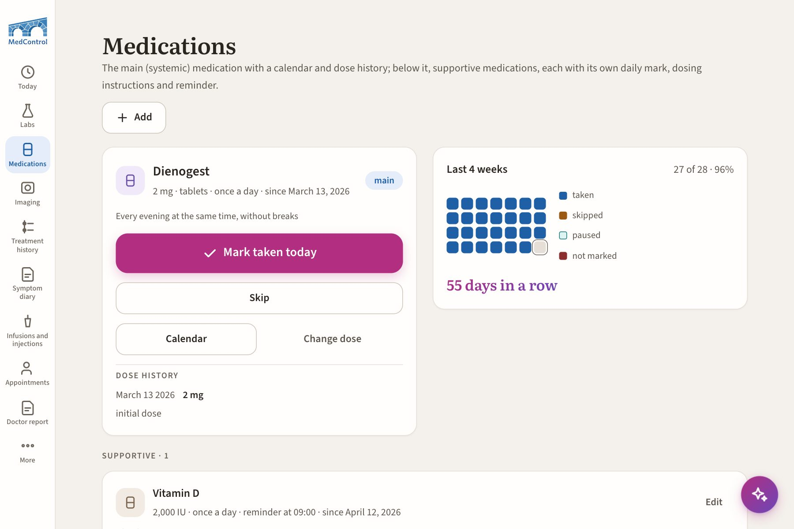
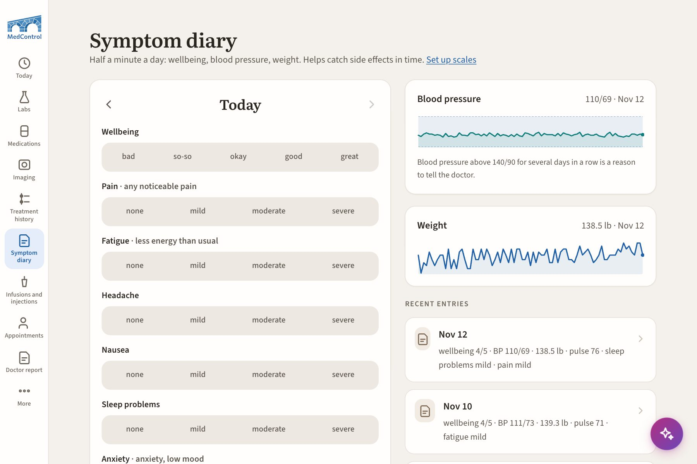

# MedControl

[Русский](README.md)

**Your whole treatment history, close at hand.**

MedControl gathers lab results, scans, prescriptions and how you feel into one history. It is for people who are monitored or treated over a long time and need to see their values as a trend, not one report at a time.

The diagnosis can be anything: endometriosis, thyroid disease, an autoimmune condition, cancer, life after a transplant. They have one thing in common: tests and scans repeat for years, prescriptions change, and there are several doctors.

The program is free and open source. It runs on your own computer or server, and data leaves it only if you connect an AI service, Telegram, a cloud backup or an external AI agent yourself.

> MedControl is not a medical device and does not replace a doctor. AI answers need checking, and the alert thresholds have not been reviewed by a doctor. [What else to know first](#before-you-start).

> **MedControl works in English and Russian:** the interface, the PDF doctor report, exports, the Telegram bot, and AI prompts and answers. You choose the language on the first-run page and in Settings. The detailed documentation in `docs/` is mostly in Russian for now. This README, the code and its comments are in English. Translations are welcome (see [CONTRIBUTING.md](CONTRIBUTING.md)).

<p>
  
  
</p>

All screenshots use the demo data of an invented patient.

**[Who it is for](#who-it-is-for) · [What it does](#what-it-does) · [Download for your computer](#download-for-your-computer) · [How to try it on a server](#how-to-try-it-on-a-server)**

## Who it is for

- **The person being treated or monitored.** The whole history is close at hand: you no longer carry dates, doses and past results in your head.
- **Family and friends.** Help someone close to you through treatment without getting lost in lab results, prescriptions and scans. You can keep the history for them.
- **At the doctor's appointment.** You arrive with a timeline of the treatment and the trends in your values, not with a folder of scattered documents.

You will recognise your situation if:

- your lab results sit in dozens of PDFs from different labs, in different units;
- your scans are on discs, the reports in a folder, the prescriptions in messages and discharge summaries;
- doses have changed, there have been pauses, and you carry the dates in your head;
- before every visit you work out again what changed since last time and what to ask.

MedControl will not suit you if you need separate logins for several people (there is one user, with no roles, no second patient and no doctor login), a ready-made website with a sign-up form (you install it yourself) or an interface in a language other than English or Russian.

## What it does

- **Labs.** A PDF from the lab becomes rows in a "marker × month" table. Units are converted to one, out-of-range values are highlighted, and every marker has a chart.
- **Medications.** Dose history and pauses, a dosing calendar, a Telegram reminder with "Mark taken" and "Skip" buttons.
- **Scans and documents.** CT, MRI, ultrasound and X-ray with their reports, discharge summaries and consultations in the medical history. Text from PDFs and scans is extracted on its own and becomes searchable.
- **Diary.** How you feel, symptoms, blood pressure, weight and temperature: from the website, in one line to Telegram, or from Apple Health.
- **Alerts.** Rules check every lab result and diary entry. When a value crosses a threshold, you get a notice.
- **Doctor report.** A PDF for the period you choose: the course of the disease, the treatment, lab and imaging trends, current drugs, questions for the visit. The report does not replace original documents.
- **AI on your own key.** It reads unfamiliar lab reports, explains results in plain words and prepares questions for the visit. Under every answer you can open "What the model saw": the exact text it received. Without AI everything else works as usual.

Alert thresholds, diary scales and the briefing for the AI come from the treatment protocol; you choose it on first start and change it in Settings. "General lab monitoring" is not tied to a diagnosis or a drug. There are ready examples for hypothyroidism, endometriosis, methotrexate, lenvatinib, chemotherapy, immunotherapy, kidney transplant and haemodialysis. No protocol has been reviewed by a doctor: check the thresholds with yours.

Every screen is described in detail in [docs/OVERVIEW.md](docs/OVERVIEW.md) (Russian).

| | |
|---|---|
|  |  |
| A marker's trend with its reference range | The doctor report as a PDF |
|  |  |
| Medications: dose history and dosing calendar | Diary: how you feel, blood pressure, weight |

## Your history, under your control

MedControl runs on your own hardware, and its authors have no access to your data. Outside services are connected only if you choose to:

- an AI provider receives the text of requests and the files you send for reading;
- Telegram receives reminders and whatever you send to the bot;
- cloud storage receives an encrypted copy;
- an external AI agent (MCP, off by default) sees what you allow;
- a sample of a lab report for a new lab is sent only anonymized and only when you choose to send it.

On a server, a copy of the database and files is made every night. All data can be exported as one ZIP at any time, and the archive can be loaded into a new installation. In detail: [what leaves your machine and how backups work](docs/OVERVIEW.md#что-уходит-наружу) (Russian).

## Download for your computer

The desktop version runs on one computer, without Docker or a terminal.

| Computer | Download |
|---|---|
| Mac with an Apple chip (M1 and later) | [MedControl-macOS-AppleSilicon.dmg](https://github.com/kubokot-tech/med-control/releases/latest/download/MedControl-macOS-AppleSilicon.dmg) |
| Mac with an Intel processor | [MedControl-macOS-Intel.dmg](https://github.com/kubokot-tech/med-control/releases/latest/download/MedControl-macOS-Intel.dmg) |
| Windows 10 or 11, 64-bit | [MedControl-Windows-Setup.exe](https://github.com/kubokot-tech/med-control/releases/latest/download/MedControl-Windows-Setup.exe) |

Which Mac you have: the Apple menu in the top left corner of the screen → About This Mac. "Chip Apple M…" means Apple, "Processor Intel" means Intel.

The builds are not signed by a developer yet, so on the first start the system warns that it cannot verify the app. This happens with every app that has not been through Apple's and Microsoft's checks.

**macOS**
1. Open the downloaded `.dmg` and drag MedControl to Applications.
2. Start MedControl from Applications. macOS says it cannot verify the developer: click Done.
3. Open System Settings → Privacy & Security, scroll down to the line about MedControl, click Open Anyway and confirm with your Mac password. You only do this once.
4. If macOS says the app is damaged, open Terminal and run `xattr -cr /Applications/MedControl.app`, then start it again.

**Windows**
1. Run the downloaded `MedControl-Windows-Setup.exe`.
2. If "Windows protected your PC" appears, click More info → Run anyway. No administrator rights are needed: it installs for your account.
3. Start MedControl from the Start menu.

The first start takes up to a minute. After that it is the same as the server version: a password, a language and five setup steps. Data lives in your user folder (`~/Library/Application Support/MedControl` on a Mac, `%APPDATA%\MedControl` on Windows) and stays there when you update. From version 0.4.0 the app offers new versions itself: it shows what changed, saves a copy of the database and installs the update once you agree. Earlier versions are updated by installing the new one over them. What the desktop version lacks: phone access, nightly backups (save "Full data archive" yourself), DICOM imaging and Apple Health; Telegram works while the app is open. More: [docs/DESKTOP.md](docs/DESKTOP.md) (Russian).

## How to try it on a server

The server version lets you open MedControl from a phone and keeps nightly backups. You will need Docker, a terminal, 2 GB of free memory, 5 GB of disk space and about half an hour. If Docker and the terminal are new to you, there is a [step-by-step guide](docs/INSTALL.md) (Russian) for Windows, macOS, Linux and Synology. The first time, it is easier to go through it with someone who has used a terminal before.

```bash
git clone https://github.com/kubokot-tech/med-control.git
cd med-control
```

**Try the demo.** An invented patient with endometriosis, eight months of treatment: nine lab reports, four ultrasounds, a diary, visits, infusions and notes. It is a separate stack and can run next to a real installation.

```bash
DEMO_LANG=en scripts/demo.sh
```

The script starts the demo in English at http://localhost:3101, with US units and formats, and prints the password. On Windows run it from Git Bash or WSL. The other demo commands: [docs/OPERATIONS.md](docs/OPERATIONS.md) (Russian).

**Install it for yourself.**

```bash
docker compose up -d --build
```

Open http://localhost:3001 in a browser. The first page asks for a password, language, time zone and region. Right after it MedControl shows a **password recovery code** once. Write it down: if you forget the password, this code is the only way back in. Then five steps fill the app in right away; any step can be skipped. No `.env` is needed.

If the site is open to the network from the start (`BIND_ADDR`, `APP_URL` other than localhost), the page asks for a first-run code from the log: `docker compose logs gateway | grep SETUP_CODE`.

The server version needs a computer that is always on: a NAS, a home server or a VPS. On a phone the site opens in a browser and can be added to the home screen like an app. The desktop version for macOS and Windows is described above. How the versions differ and how to open access from a phone: [docs/INSTALL.md](docs/INSTALL.md) (Russian).

## Before you start

- MedControl is not a medical device. It does not make diagnoses and does not replace a doctor; decisions about treatment are the doctor's.
- AI answers, lab report reading and unit conversion can go wrong. Check the values against the source PDF, especially from a new lab.
- The alert thresholds were written by one patient for their own therapy and have not been reviewed by a doctor. No alert does not mean everything is fine. If you feel unwell, go to a doctor, not to the program.
- Reports from four Russian labs are read without AI: MKNC, Helix, Hadassah (Moscow) and DNKOM. Others are read by the model and you check the rows; without an AI key you enter results by hand. To add your own lab: [docs/LAB-PARSERS.md](docs/LAB-PARSERS.md) (Russian).
- Maintained by one person in their spare time, with no guarantees or timelines.

Full text: [DISCLAIMER.en.md](DISCLAIMER.en.md).

## Where it comes from

MedControl began during my own long treatment. I built the program for myself, and its features came from problems I ran into. Over time I thought it could be useful to other people, which is why MedControl is free and open source. [Why I made MedControl](docs/STORY.en.md).

If you use the program, tell me whether it helps you: in [Issues](https://github.com/kubokot-tech/med-control/issues) or by email at [support@med-control.app](mailto:support@med-control.app). Write there too if you would like to support the project. Parsers for new labs and translations are especially welcome. How contributing works: [CONTRIBUTING.md](CONTRIBUTING.md).

## Documentation

These guides are in Russian for now. Installation and phone access: [docs/INSTALL.md](docs/INSTALL.md). Updating and rolling back: [docs/UPDATE.md](docs/UPDATE.md). Every screen, Telegram, AI, backups and what is postponed: [docs/OVERVIEW.md](docs/OVERVIEW.md). Restoring from backups: [docs/RESTORE.md](docs/RESTORE.md).

Other topics: [labs](docs/LAB-PARSERS.md), [reference ranges](docs/REFERENCE-RANGES.md), [languages and region](docs/I18N.md), [desktop version](docs/DESKTOP.md), [AI agents (MCP)](docs/MCP.md), [operations](docs/OPERATIONS.md), [architecture](docs/ARCHITECTURE.md), [roadmap](docs/ROADMAP.md), [product voice](docs/BRAND-VOICE.md).

## For developers

**Stack.** Postgres 16 · Fastify (Node 22) · Next.js 15 · Caddy · Orthanc · rclone · Docker Compose; the desktop version uses Tauri and PGlite. The gateway reads PDFs itself; the FastAPI parsers are kept in reserve (the `python` profile).

**Tests.** `cd gateway && npm test`, `npm run test:integration` with `TEST_DATABASE_URL` on a separate database, `cd frontend && npm run typecheck`.

**Security.** One port is published, by default only on this computer; the database and the API are not reachable from outside. HTTPS comes from Tailscale, Cloudflare Tunnel or your own proxy. Details in [docs/OPERATIONS.md](docs/OPERATIONS.md) (Russian).

## License

Copyright © 2026 MedControl authors (Авторы MedControl). Licensed under AGPL-3.0, see [LICENSE](LICENSE). Third-party components and their licenses (fonts: SIL OFL 1.1): [THIRD-PARTY-NOTICES.md](THIRD-PARTY-NOTICES.md). Release notes: [CHANGELOG.md](CHANGELOG.md) (Russian).
