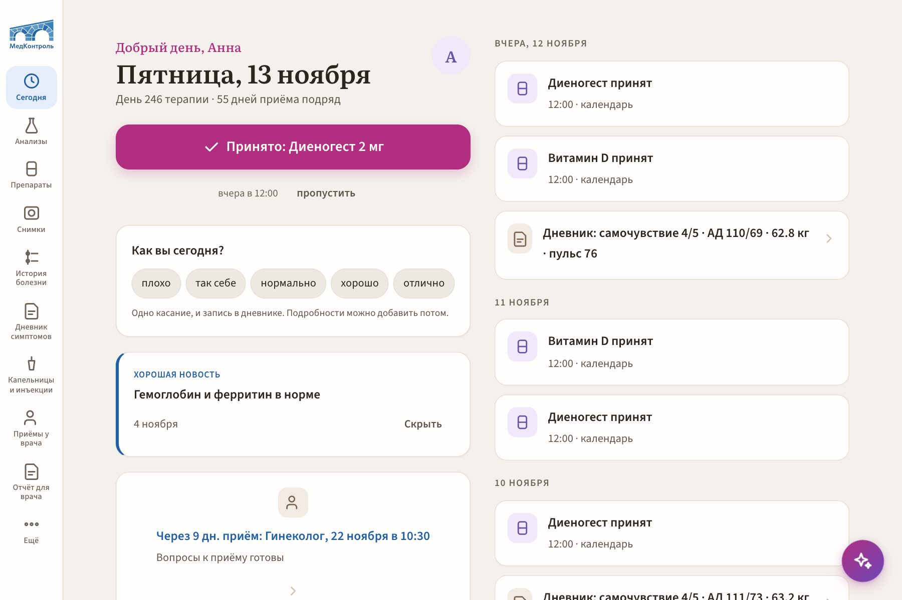
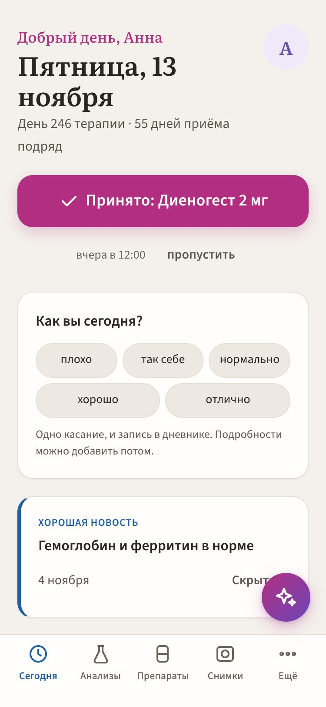
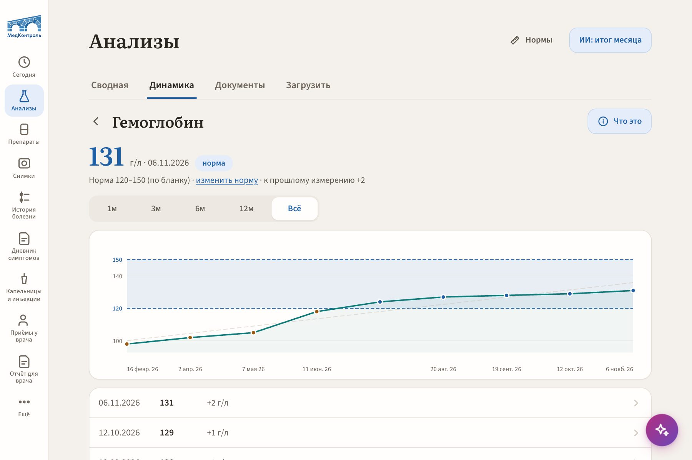
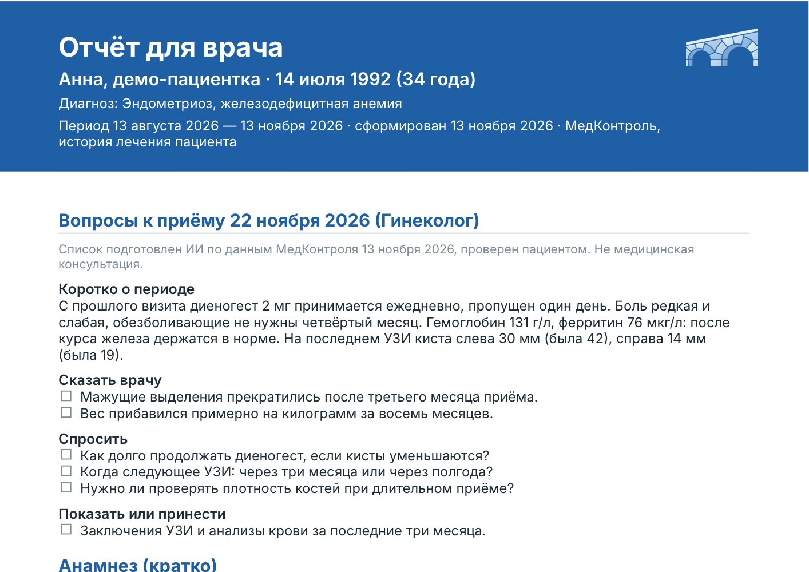
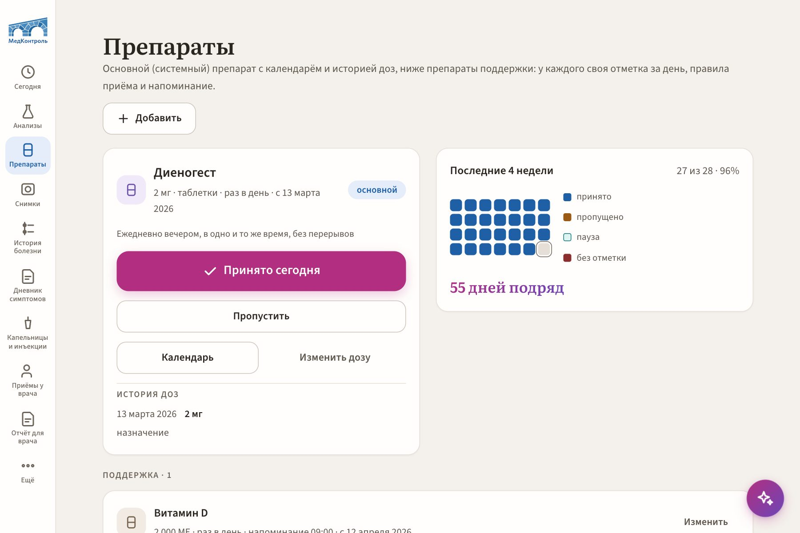
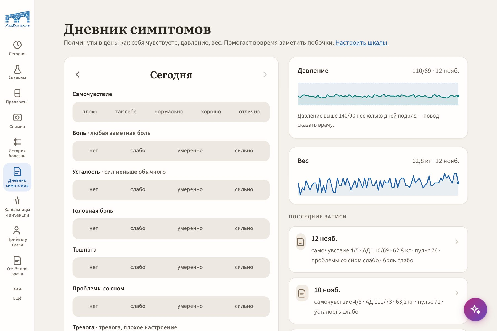

# MedControl (МедКонтроль)

[English](README.en.md)

**Вся история лечения под рукой.**

МедКонтроль собирает в одну историю результаты анализов, обследования, назначения и самочувствие. Он для тех, кто наблюдается или лечится долго и кому важно видеть показатели в динамике, а не по одному бланку.

Диагноз может быть любым: эндометриоз, болезни щитовидной железы, аутоиммунные заболевания, онкология, жизнь после трансплантации. Общее у них одно: анализы и обследования повторяются годами, назначения меняются, врачей несколько.

Программа бесплатная, исходный код открыт. Она работает на вашем компьютере или сервере, а данные уходят наружу, только если вы сами подключите ИИ, Telegram, облачную копию или внешнего ИИ-агента.

> МедКонтроль не медицинское изделие и не заменяет врача. Ответы ИИ надо проверять, пороги тревог не проверены врачом. [Что ещё стоит знать заранее](#что-стоит-знать-заранее).

<p>
  
  
</p>

Все скриншоты сделаны на демо-данных вымышленной пациентки.

**[Кому пригодится](#кому-пригодится) · [Что умеет](#что-умеет) · [Скачать для компьютера](#скачать-для-компьютера) · [Как попробовать на сервере](#как-попробовать-на-сервере)**

## Кому пригодится

- **Тому, кто лечится или наблюдается.** Вся история под рукой: даты, дозы и прошлые результаты не нужно держать в голове.
- **Близким.** Помогайте близкому человеку проходить лечение, не теряясь в анализах, назначениях и обследованиях. Историю можно вести за него.
- **На приёме у врача.** Вы приходите с хронологией лечения и динамикой показателей, а не с папкой разрозненных документов.

Вы узнаете свою ситуацию, если:

- результаты анализов лежат в десятках PDF из разных лабораторий, с разными единицами;
- снимки хранятся на дисках, заключения в папке, назначения в переписках и выписках;
- доза менялась, были паузы, и даты приходится держать в голове;
- перед каждым визитом вы заново выясняете, что изменилось с прошлого раза и о чём спросить.

МедКонтроль не подойдёт, если нужны отдельные входы для нескольких человек (пользователь один, ролей, второго пациента и входа для врача нет), готовый сайт с регистрацией (программу ставите вы сами) или интерфейс не на русском и не на английском.

## Что умеет

- **Анализы.** PDF из лаборатории становится строками таблицы «показатель × месяц». Единицы приводятся к одной, значения вне нормы подсвечены, по каждому показателю есть график.
- **Препараты.** История доз и пауз, календарь приёма, напоминание в Telegram с кнопками «Принято» и «Пропустить».
- **Обследования и документы.** КТ, МРТ, УЗИ и рентген с заключениями, выписки и консультации в истории болезни. Текст из PDF и сканов достаётся сам и виден поиску.
- **Дневник.** Самочувствие, симптомы, давление, вес и температура: с сайта, одной строкой в Telegram или из Apple Health.
- **Тревоги.** Правила смотрят на каждый анализ и запись дневника. Когда значение переходит порог, приходит уведомление.
- **Отчёт для врача.** PDF за выбранный период: история заболевания, лечение, динамика анализов и обследований, текущие препараты, вопросы к приёму. Отчёт не заменяет оригиналы документов.
- **ИИ по вашему ключу.** Разбирает незнакомые бланки, объясняет результаты простыми словами, готовит вопросы к приёму. Под каждым ответом раскрывается «Что видела модель»: точный текст, который она получила. Без ИИ всё остальное работает как обычно.

Пороги тревог, шкалы дневника и вводную для ИИ задаёт протокол лечения, его выбирают при первом запуске и меняют в Настройках. «Общий контроль анализов» не привязан к диагнозу и препарату. Готовые примеры есть для гипотиреоза, эндометриоза, метотрексата, ленватиниба, химиотерапии, иммунотерапии, трансплантации почки и гемодиализа. Ни один протокол не проверен врачом: сверьте пороги с лечащим врачом.

Каждый экран подробно описан в [docs/OVERVIEW.md](docs/OVERVIEW.md), там же один обычный день с МедКонтролем.

| | |
|---|---|
|  |  |
| Динамика показателя с нормой | Отчёт для врача в PDF |
|  |  |
| Препараты: история доз и календарь приёма | Дневник: самочувствие, давление, вес |

## История под вашим контролем

МедКонтроль работает на вашем оборудовании, авторы не имеют доступа к вашим данным. Внешние сервисы подключаются только по вашему выбору:

- провайдер ИИ получает текст запросов и файлы, которые вы отправили на разбор;
- Telegram получает напоминания и то, что вы отправляете боту;
- облачное хранилище получает зашифрованную копию;
- внешний ИИ-агент (MCP, по умолчанию выключен) видит то, что вы разрешили;
- образец бланка для новой лаборатории уходит только обезличенным и только по вашему действию.

На сервере каждую ночь делается копия базы и файлов. Все данные в любой момент выгружаются одним ZIP, архив загружается и в новую установку. Подробно: [что уходит наружу и как устроены бэкапы](docs/OVERVIEW.md#что-уходит-наружу).

## Скачать для компьютера

Настольная версия работает на одном компьютере, без Docker и без терминала.

| Компьютер | Скачать |
|---|---|
| Mac с процессором Apple (M1 и новее) | [MedControl-macOS-AppleSilicon.dmg](https://github.com/kubokot-tech/med-control/releases/latest/download/MedControl-macOS-AppleSilicon.dmg) |
| Mac с процессором Intel | [MedControl-macOS-Intel.dmg](https://github.com/kubokot-tech/med-control/releases/latest/download/MedControl-macOS-Intel.dmg) |
| Windows 10 или 11, 64 бит | [MedControl-Windows-Setup.exe](https://github.com/kubokot-tech/med-control/releases/latest/download/MedControl-Windows-Setup.exe) |

Какой у вас Mac: меню с яблоком в левом верхнем углу экрана → «Об этом Mac». «Чип Apple M…» значит Apple, «Процессор Intel» значит Intel.

Сборки пока без подписи разработчика, поэтому при первом запуске система предупредит, что не может проверить программу. Так бывает со всеми программами, которые ещё не прошли проверку Apple и Microsoft.

**macOS**
1. Откройте скачанный `.dmg` и перетащите MedControl в папку «Программы».
2. Запустите MedControl из «Программ». macOS скажет, что не может проверить разработчика: нажмите «Готово».
3. Откройте «Системные настройки» → «Конфиденциальность и безопасность», внизу у строки про MedControl нажмите «Всё равно открыть» и подтвердите паролем от Mac. Это нужно один раз.
4. Если macOS пишет, что приложение повреждено, откройте «Терминал» и выполните `xattr -cr /Applications/MedControl.app`, затем запустите снова.

**Windows**
1. Запустите скачанный `MedControl-Windows-Setup.exe`.
2. Если появится «Система Windows защитила ваш компьютер», нажмите «Подробнее» → «Выполнить в любом случае». Права администратора не нужны: программа ставится для вашей учётной записи.
3. Запускайте MedControl из меню «Пуск».

Первый запуск занимает до минуты. Дальше всё как в серверной версии: пароль, язык и пять шагов настройки. Данные лежат в папке пользователя (`~/Library/Application Support/MedControl` на Mac, `%APPDATA%\MedControl` на Windows) и остаются на месте при обновлении. С версии 0.4.1 программа сама предлагает новую версию: показывает, что изменилось, сохраняет копию базы и ставит обновление после вашего согласия. Более ранние версии обновляются установкой поверх. Чего в настольной версии нет: доступа с телефона, ночных бэкапов (сохраняйте «Архив всех данных» сами), снимков DICOM и Apple Health; Telegram работает, пока программа открыта. Подробнее: [docs/DESKTOP.md](docs/DESKTOP.md).

## Версия для iPad

Полноценный МедКонтроль на самом планшете, без сервера и без компьютера: история, файлы и системные напоминания работают в приложении, историю закрывает Face ID. Telegram на iPad нет. Пока редакция в разработке: собирается из исходников с подписью Apple, готовых сборок в релизах нет. Как устроено и как собрать: [docs/IPAD.md](docs/IPAD.md).

## Как попробовать на сервере

Серверная версия нужна, чтобы открывать МедКонтроль с телефона и получать ночные бэкапы. Понадобятся Docker, терминал, 2 ГБ свободной памяти, 5 ГБ на диске и около получаса. Если Docker и терминал для вас в новинку, откройте [пошаговую инструкцию](docs/INSTALL.md) для Windows, macOS, Linux и Synology. Первый раз её проще пройти вместе с тем, кто уже работал с терминалом.

```bash
git clone https://github.com/kubokot-tech/med-control.git
cd med-control
```

**Посмотреть демо.** Вымышленная пациентка с эндометриозом, восемь месяцев лечения: девять бланков анализов, четыре УЗИ, дневник, приёмы, капельницы и заметки. Стенд отдельный, его можно поднять рядом с настоящей установкой.

```bash
scripts/demo.sh
```

Скрипт запускает демо на http://localhost:3101 и печатает пароль. На Windows запускайте его из Git Bash или WSL. Остальные команды демо: [docs/OPERATIONS.md](docs/OPERATIONS.md).

**Поставить для себя.**

```bash
docker compose up -d --build
```

Откройте в браузере http://localhost:3001. Первая страница попросит пароль, язык, часовой пояс и регион. Сразу после неё МедКонтроль один раз покажет **код восстановления пароля**. Запишите его: если забыть пароль, вернуть доступ можно только им. Затем пять шагов помогут сразу наполнить программу, любой шаг можно пропустить. `.env` для этого не нужен.

Если сайт сразу открыт в сеть (`BIND_ADDR`, `APP_URL` не localhost), страница попросит код первого запуска из журнала: `docker compose logs gateway | grep "Код первого запуска"`.

Серверной версии нужен компьютер, который включён всегда: NAS, домашний сервер или VPS. На телефоне сайт открывается в браузере и ставится на экран «Домой» как приложение. Настольная версия для macOS и Windows описана выше. Чем версии отличаются и как открыть доступ с телефона: [docs/INSTALL.md](docs/INSTALL.md).

## Что стоит знать заранее

- МедКонтроль не медицинское изделие. Он не ставит диагнозы и не заменяет врача, решения о лечении принимает врач.
- Ответы ИИ, разбор бланков и пересчёт единиц могут ошибаться. Сверяйте значения с исходным PDF, особенно из новой лаборатории.
- Пороги тревог записаны одним пациентом для своей терапии и не проверены врачом. Отсутствие тревоги не значит, что всё в порядке. При плохом самочувствии обращайтесь к врачу, а не к программе.
- Без ИИ разбираются бланки четырёх лабораторий: МКНЦ, Хеликс, Хадасса (Москва) и ДНКОМ. Остальные разбирает модель с проверкой строк, а без ключа ИИ результаты вводятся вручную. Как добавить свою лабораторию: [docs/LAB-PARSERS.md](docs/LAB-PARSERS.md).
- Проект ведёт один человек в свободное время, без гарантий и сроков.

Полный текст: [DISCLAIMER.md](DISCLAIMER.md).

## Откуда проект

МедКонтроль появился во время моего собственного длительного лечения. Я делал программу для себя, и её функции появились из задач, с которыми я сам сталкивался. Со временем я подумал, что она может пригодиться другим людям, поэтому МедКонтроль бесплатный, а его исходный код открыт. [Почему я сделал МедКонтроль](docs/STORY.md).

Если вы пользуетесь программой, расскажите, помогает ли она вам: в [Issues](https://github.com/kubokot-tech/med-control/issues) или по почте [support@med-control.app](mailto:support@med-control.app). Туда же пишите, если хотите поддержать проект. Особенно пригодятся разбор бланков новых лабораторий и переводы. Как устроено участие: [CONTRIBUTING.md](CONTRIBUTING.md).

## Документация

Установка и доступ с телефона: [docs/INSTALL.md](docs/INSTALL.md). Обновление и откат: [docs/UPDATE.md](docs/UPDATE.md). Каждый экран, Telegram, ИИ, бэкапы и что отложено: [docs/OVERVIEW.md](docs/OVERVIEW.md). Восстановление из бэкапов: [docs/RESTORE.md](docs/RESTORE.md).

Отдельные темы: [лаборатории](docs/LAB-PARSERS.md), [нормы анализов](docs/REFERENCE-RANGES.md), [языки и регион](docs/I18N.md), [настольная версия](docs/DESKTOP.md), [версия для iPad](docs/IPAD.md), [ИИ-агенты (MCP)](docs/MCP.md), [эксплуатация](docs/OPERATIONS.md), [архитектура](docs/ARCHITECTURE.md), [планы](docs/ROADMAP.md), [голос продукта](docs/BRAND-VOICE.md).

## Для разработчиков

**Стек.** Postgres 16 · Fastify (Node 22) · Next.js 15 · Caddy · Orthanc · rclone · Docker Compose; настольная версия на Tauri и PGlite; версия для iPad — Tauri, gateway и PGlite внутри страницы WKWebView. PDF читает gateway, FastAPI-парсеры в запасе (профиль `python`).

**Тесты.** `cd gateway && npm test`, `npm run test:integration` с `TEST_DATABASE_URL` на отдельной базе (или `TEST_DB=pglite` без Postgres), `cd frontend && npm run typecheck`, `cd ipad && npm test`.

**Безопасность.** Наружу публикуется один порт, по умолчанию только на этом компьютере; база и API снаружи недоступны. HTTPS даёт Tailscale, Cloudflare Tunnel или ваш прокси. Подробности: [docs/OPERATIONS.md](docs/OPERATIONS.md).

## Лицензия

Copyright © 2026 Авторы MedControl. Код открыт под AGPL-3.0, см. [LICENSE](LICENSE). Сторонние компоненты и их лицензии (шрифты: SIL OFL 1.1): [THIRD-PARTY-NOTICES.md](THIRD-PARTY-NOTICES.md). История версий: [CHANGELOG.md](CHANGELOG.md).
